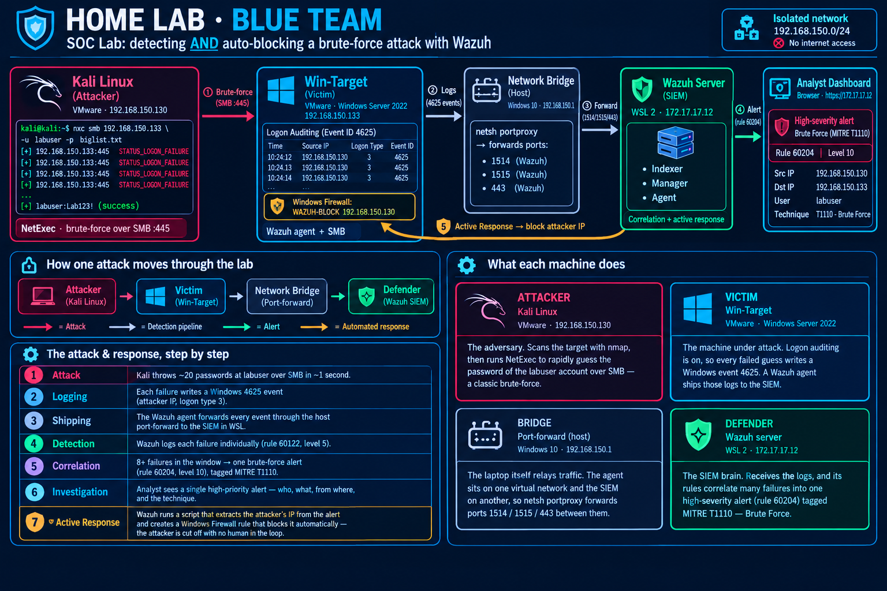
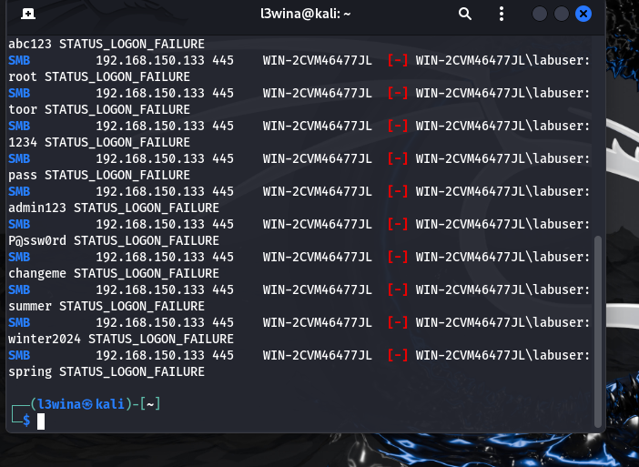
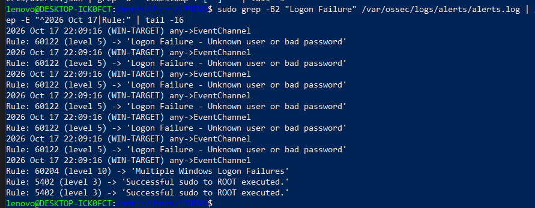
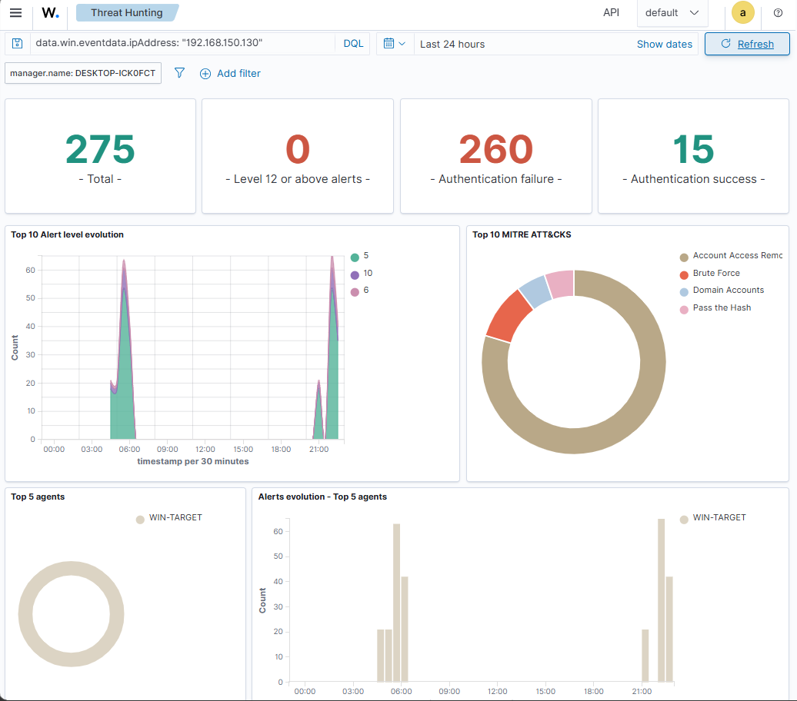
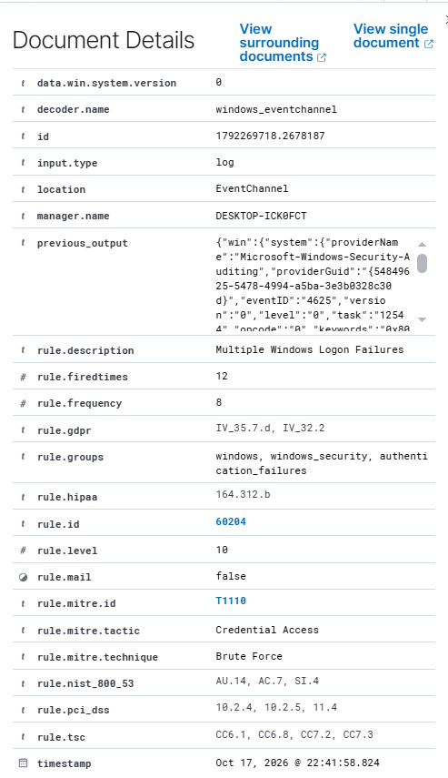
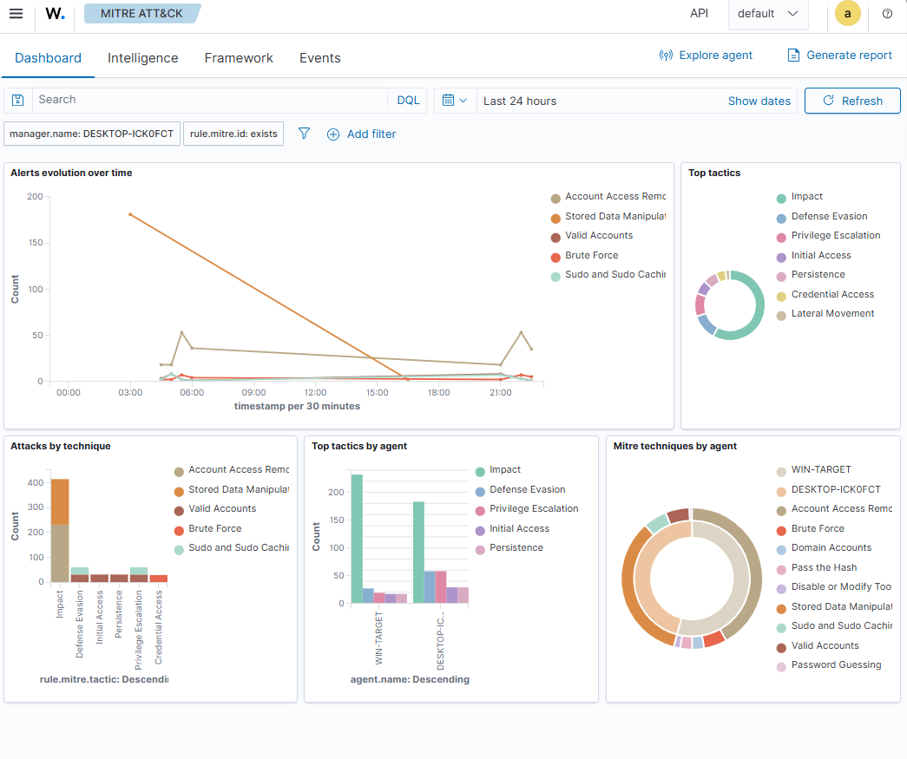
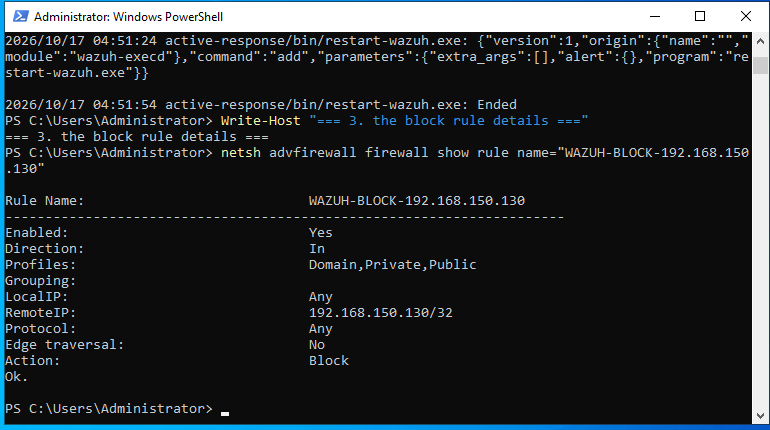

# 🛡️ SOC Home Lab — Brute-Force Detection & Automated Response with Wazuh

A self-contained **blue-team home lab** that detects a brute-force attack against a Windows server **and automatically blocks the attacker's IP** — the full *detect → correlate → classify → respond* loop a real SOC runs, on a single laptop.

> Built with **Wazuh** on an isolated VMware network after my Azure student plan was refused. The local pivot turned out to be a deeper learning experience than the original cloud plan.



---

## 📌 Overview

Three virtual machines on one **isolated network (`192.168.150.0/24`, no internet)** simulate a real attack and its response:

| Role | Machine | IP | Function |
|------|---------|-----|----------|
| 🔴 **Attacker** | Kali Linux | `192.168.150.130` | Runs a brute-force against the target over SMB (NetExec) |
| 🔵 **Victim** | Windows Server 2022 | `192.168.150.133` | Target machine; Wazuh agent + logon auditing (Event 4625) |
| 🟢 **Defender (SIEM)** | Wazuh (WSL2) | `172.17.17.12` | Indexer + Manager + Agent; detection, correlation & active response |
| ⚙️ **Bridge** | Windows 10 host | `192.168.150.1` | `netsh portproxy` forwarding ports `1514 / 1515 / 443` to the SIEM in WSL |

Everything runs on **one 16 GB laptop**.

---

## ⚔️ The attack → detection → response chain

| # | Stage | What happens |
|---|-------|--------------|
| 1 | **Attack** | From Kali, NetExec throws ~20 passwords at the `labuser` account over SMB in ~1 second |
| 2 | **Logging** | Each failed logon writes a **Windows Event 4625** (attacker IP, logon type 3) |
| 3 | **Shipping** | The Wazuh agent forwards every event through the host port-forward to the SIEM in WSL |
| 4 | **Detection** | Wazuh logs each failure individually — **rule 60122** (level 5) |
| 5 | **Correlation** | 8+ failures in the window → one brute-force alert — **rule 60204** (level 10), tagged **MITRE T1110** |
| 6 | **Investigation** | The analyst sees a single high-priority alert: who, what, from where, and the technique |
| 7 | **✅ Active Response** | A script reads the attacker's IP from the alert and creates a **Windows Firewall rule that blocks it automatically** — no human in the loop |

---

## 🧰 Tech stack

- **SIEM / XDR:** Wazuh 4.14 (Indexer, Manager, Dashboard) on WSL2 (Ubuntu)
- **Target:** Windows Server 2022 + Wazuh agent, Security logon auditing (Event ID 4625)
- **Attacker:** Kali Linux + [NetExec](https://github.com/Pennyw0rth/NetExec) (SMB brute-force)
- **Framework:** MITRE ATT&CK — **T1110 Brute Force** (Credential Access)
- **Response:** Wazuh Active Response + PowerShell + Windows Firewall (`netsh advfirewall`)
- **Infrastructure:** VMware Workstation, WSL2, `netsh portproxy`

---

## 🔬 How it works

### 1. The attack (Kali)

```bash
nxc smb 192.168.150.133 -u labuser -p biglist.txt
```



### 2. Detection & correlation (Wazuh manager)

Each failure fires **rule 60122**; once the threshold (8 failures) is reached, **rule 60204** correlates them into a single high-severity brute-force alert.



### 3. Threat Hunting dashboard

Filtering on the attacker's IP isolates the whole campaign — hundreds of auth failures, mapped to **Brute Force** in the MITRE donut.



### 4. The correlated alert (MITRE T1110)

One alert carries everything: rule `60204`, level `10`, technique **T1110 — Brute Force**, tactic **Credential Access**, the attacker IP, the targeted user, and compliance mappings (PCI-DSS, HIPAA, NIST 800-53, GDPR).



### 5. MITRE ATT&CK view



### 6. Automated response — the attacker is blocked

The active-response script extracts the attacker's IP from the alert and creates a Windows Firewall rule (`WAZUH-BLOCK-<ip>`) that cuts it off.



---

## 🔁 Reproduce it

### 1. Configure the manager

Append [`manager/ossec.conf.snippet.xml`](manager/ossec.conf.snippet.xml) to `/var/ossec/etc/ossec.conf`, then restart:

```bash
sudo /var/ossec/bin/wazuh-control restart
```

### 2. Deploy the response scripts on the agent (Windows)

Copy both files into the agent's active-response folder:

```
C:\Program Files (x86)\ossec-agent\active-response\bin\
  ├── block-attacker.cmd
  └── block-attacker.ps1
```

Restart the agent so it syncs the new command:

```powershell
Restart-Service WazuhSvc
```

### 3. Enable logon auditing on the target

```powershell
auditpol /set /subcategory:"Logon" /success:enable /failure:enable
```

### 4. Launch the attack from Kali

```bash
nxc smb <TARGET_IP> -u labuser -p biglist.txt
```

Watch `block-events.log` on the agent — the attacker's IP is extracted and blocked automatically.

---

## 🧠 Lessons learned (the hard part was the plumbing)

The attack and detection were the easy parts. The real engineering challenge was **running the Wazuh manager inside WSL2**:

- Agent → manager traffic (events) flows fine through the `netsh portproxy` relay.
- But the manager → agent **push** (the active-response command) **degrades** on an aged connection through that same relay: the auto-block fires reliably right after a fresh connection and lags once the tunnel sits idle.

Diagnosing this — confirming the agent was connected ✅ and events were flowing ✅, then isolating the failure to the **server-push direction through the WSL NAT relay** — taught me far more about how SIEM agents actually communicate than any tutorial would.

> **Permanent fix:** switch WSL2 to **mirrored networking mode**, which removes the port-proxy entirely and gives the manager a direct path back to the agent.

---

## 📂 Repository structure

```
wazuh-soc-lab/
├── README.md
├── images/                       # screenshots + architecture diagram
├── manager/
│   └── ossec.conf.snippet.xml    # command + active-response config
└── active-response/
    ├── block-attacker.cmd        # wrapper invoked by Wazuh
    └── block-attacker.ps1         # extracts attacker IP + firewall block
```

---

## ⚠️ Disclaimer

This is an **isolated lab** for educational purposes. All IPs are private (RFC 1918), the environment has **no internet exposure**, and the credentials are throwaway lab values. Only ever run offensive tooling against systems you own.
